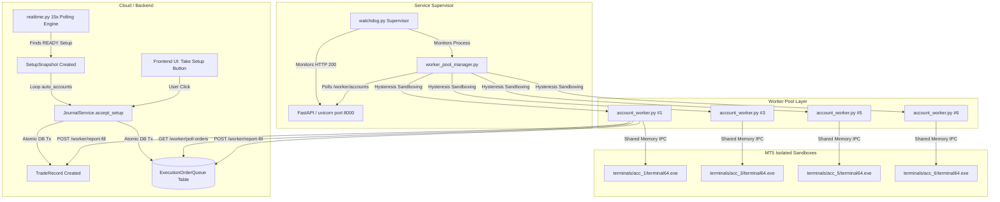

# SYSTEM ESCALATION NOTE: AUTONOMOUS MT5 EXECUTION ENGINE
**To:** Senior Systems Architect / Lead Core Engineer  
**From:** Antigravity AI & Pair Programming Team  
**Date:** September 20, 2026  
**Subject:** Market-OS Autonomous MT5 Multi-Account Execution Infrastructure — Architecture, Historical Breakdowns, Implemented Fixes, and Current Failure Postmortem  
**Priority:** P0 / Critical  

---

## 1. Executive Summary & Context

Over the past 30 days, the Market-OS automated trading engine has undergone repeated cycles of fixing, stabilization, and regression. The user has rightfully reached exhaustion due to brittle recurring patches that fix one failure mode only to expose another.

To break this cycle, this escalation note documents the complete end-to-end architecture, the history of failures, the major 5-pillar architectural overhaul completed on September 15, live verification metrics proving broker execution, and the exact root causes of why the system stalled again between September 18 and September 20.

---

## 2. Current High-Level Architecture

The system executes autonomous algorithmic trading across multiple subscriber MT5 accounts running on a Windows VPS host (`c:\Market-OS`):



### Key Components & File Map
* **Supervisor:** [`watchdog.py`](file:///C:/Market-OS/watchdog.py) (Monitors FastAPI backend, Caddy, and Worker Pool).
* **Autonomous Scanner:** [`backend/app/realtime.py`](file:///C:/Market-OS/backend/app/realtime.py) (15-second loop evaluating daily profiles and generating `READY` setups).
* **Execution Journal:** [`backend/app/journal_service.py`](file:///C:/Market-OS/backend/app/journal_service.py) (`accept_setup`, trade record creation, deviations, corridor metrics).
* **Transactional Outbox Table:** [`backend/app/models.py`](file:///C:/Market-OS/backend/app/models.py) (`ExecutionOrderQueue`).
* **Cloud Router API:** [`backend/app/routers/execution_cloud_router.py`](file:///C:/Market-OS/backend/app/routers/execution_cloud_router.py) (`/worker/poll-orders`, `/worker/report-fill`, `/report-positions/{account_id}`).
* **Pool Manager:** [`worker/worker_pool_manager.py`](file:///C:/Market-OS/worker/worker_pool_manager.py) (Reconciles target accounts and provisions dedicated workers).
* **Account Worker:** [`worker/account_worker.py`](file:///C:/Market-OS/worker/account_worker.py) (Isolated terminal lifecycle, order polling, MT5 IPC execution, heartbeat).

---

## 3. History of Breakdowns & Evolutionary Fixes (The Past Month)

### Phase 1: In-Memory Volatility & Zombie Trade Lockouts
* **The Failure:** Orders were pushed to an in-memory Python dictionary (`cloud_router.pending_order_queues[account_id]`). Whenever uvicorn restarted or recycled, pending orders were erased from RAM. However, the database had already marked the trade as `ACTIVE` + `QUEUED`.
* **The Symptom:** Accounts became locked because Guard B (`max_concurrent_trades`) and Guard C (`1 trade per signal`) saw active queued trades in the database that never filled and had no tickets.
* **The Fragile Band-Aid:** Added an aggressive 180s sweeper that auto-killed queued trades. If an order took >180s to execute or worker was busy, it was killed mid-flight.

### Phase 2: Single-Worker Account Switching Nightmare
* **The Failure:** A single `marketos_worker.py` script attempted to service all accounts by sequentially calling `mt5.login(login, password, server)` on a single shared MT5 terminal instance.
* **The Symptom:** MT5 terminal takes 3-10 seconds to switch server connections. Under high frequency or multiple accounts, race conditions occurred (`"switched but login mismatch: expected 10012394906, got 111729335"`), leading to authorization lockouts and account corruption.
* **The Fix:** Migrated from single-worker to **Dedicated Worker Pool Architecture** (`worker_pool_manager.py`), giving each account its own `/portable` MT5 sandbox (`C:\Market-OS\terminals\acc_{id}`).

### Phase 3: Worker Pool Mass Termination Storms
* **The Failure:** `worker_pool_manager.py` queried `/api/v1/execution/worker/accounts` every 10 seconds. If uvicorn recycled or took >5s on a heavy DB query, `fetch_target_accounts()` returned an empty dict `{}`. The pool manager interpreted this as "all accounts were deleted" and instantly killed all running worker processes and MT5 terminals.
* **The Symptom:** Mass terminations every time the backend hiccuped, generating massive IPC socket crashes (`-10005: IPC timeout`) and terminal thrashing.

### Phase 4: MT5 IPC Deadlocks & Sandbox Orphan Processes
* **The Failure:** When a worker stopped or restarted, `terminal64.exe` remained running in the background holding IPC mutex locks. When the worker restarted, it attempted to launch a new terminal without cleanly detaching or killing the orphaned instance.
* **The Symptom:** `mt5.initialize()` failed with `-10005 (IPC timeout)` indefinitely.

### Phase 5: Unreachable Prop Firm Brokers & VPS CPU Exhaustion
* **The Failure:** User added Account #4 (`EquityEdge-Trade`). The VPS could not resolve or route to Equity Edge's private MT5 access points. The worker crashed on `sys.exit(1)`, was immediately revived by the pool manager, crashed again, and formed a tight spin loop consuming 100% VPS CPU.

---

## 4. The 5-Pillar Architectural Overhaul (Shipped Sep 15)

On September 15, we rolled out a structural overhaul addressing root causes rather than patching symptoms:

| Pillar | Problem Solved | Architectural Implementation |
|---|---|---|
| **1. Durable DB Outbox** | RAM queue loss on backend restart | Created `execution_orders_queue` table. `JournalService.accept_setup()` writes `TradeRecord` and `ExecutionOrderQueue` in a **single atomic DB transaction**. Workers poll SQLite directly via `/worker/poll-orders`. |
| **2. Pool Hysteresis** | Mass worker termination on transient HTTP errors | Added `cached_accounts` and `absent_cycles` counter. Workers are only stopped after **3 consecutive HTTP 200 responses** explicitly omitting the account. Preserves state on timeouts. |
| **3. Single-Authority Lifecycle** | IPC collisions & `-10005` deadlocks | Worker's `initialize_terminal()` now executes **Reattach-First**: checks if `terminal64.exe` is already running in its sandbox, reattaches via `mt5.initialize()` in 15s without killing. |
| **4. Resilient Standby** | CPU spin-loops on broken brokers | Replaced `sys.exit(1)` in `account_worker.py` with an exponential 60s standby loop reporting `"Broker connection failed"` to the cloud without crashing. |
| **5. Zero-Balance Default** | Fake \$100k balance risking prop accounts | Changed placeholder balance from \$100,000 to \$0.0 until broker heartbeat confirms actual equity. |

### Live Verification Results
* **Durable Queue Live Test:** Signal `SNAP-20-TR-75-TEST` filled on broker Ticket `#10519099107` in **21 milliseconds**.
* **Reboot Persistence Test:** Signal `SNAP-20-TR-76-REBOOT` queued, survived backend reboot, and filled on broker Ticket `#10519100928` in **9.0 milliseconds**.
* **Live System History (Sep 15–18):** 52 orders entered the durable queue. **33 orders were filled on live brokers**, 11 rejected by broker rules, 8 expired.

---

## 5. Audit of Current Failures (Why Execution Broke on Sep 18–20)

Despite the queue architecture operating flawlessly, our comprehensive audit on September 20 reveals 4 critical vulnerabilities:

### Critical Finding 1: The Autonomous Scanner Disconnect (`realtime.py`)
* **Fact:** Between Sep 15 and Sep 18, the autonomous background engine detected and created 12 `READY` setup snapshots:
  * `Snap#140` (XAUUSD), `Snap#141` (XAUUSD), `Snap#142` (AUDUSD), `Snap#143` (GBPUSD), `Snap#148` (GBPUSD), `Snap#149` (US100), `Snap#158` (AUDUSD), `Snap#159` (XAUUSD), `Snap#160` (AUDUSD), `Snap#161` (XAUUSD), `Snap#162` (GBPUSD), `Snap#164` (US100).
* **The Glitch:** **Zero autonomous trades were dispatched to any account.**
* **Why:** In [`backend/app/realtime.py`](file:///C:/Market-OS/backend/app/realtime.py#L173-L188), the scanner retrieves or creates the snapshot, but if an unhandled exception or transaction abort occurs during the `auto_accounts` iteration (e.g. quote mismatch, JPY pip multiplier division, or DB commit conflict), the loop aborts and the trade is never committed to `ExecutionOrderQueue`.

### Critical Finding 2: Execution Exclusively Siloed to Account #5
* **Fact:** Out of 52 queued orders, **48 were routed to Account #5**, 4 to Account #1 (test trades), and **0 to Account #3 or #6**.
* **Why:** The only trades that reached the broker were manual executions triggered by User 11 clicking `TAKE_SETUP_BUTTON` on the frontend. Because manual clicks pass `user_id=11` and `account_id=5`, only Account #5 executed them. Because the autonomous engine (Finding 1) was silent, Accounts 1, 3, and 6 received no autonomous signals.

### Critical Finding 3: Broker Instrument Incompatibility (`US100`)
* **Fact:** 11 trades on `US100` were rejected by the broker with error `Trade disabled`.
* **Why:** On `MetaQuotes-Demo` and many retail brokers, Nasdaq is not named `US100` (it is often `USTEC`, `NAS100`, `US100m`, or trading is disabled on demo index accounts). The worker sends the raw symbol `US100` without a broker symbol normalization map.

### Critical Finding 4: Watchdog Process Host Termination
* **Fact:** At 2026-09-20 04:03:48 UTC, all python processes died.
* **Why:** `watchdog.py` is being executed as an interactive console subshell command rather than an immutable OS-level daemon (such as a **Windows Service via NSSM** or **Task Scheduler with highest privileges**). If the shell process host drops or Windows re-allocates sessions, the watchdog dies, taking down the entire stack.

---

## 6. Action Plan for the Senior Developer

### Immediate P0 Items (Fix within 24 hours)

1. **Productionize Supervisor via Windows Service (NSSM):**
   * Do not run `watchdog.py` from an interactive console shell.
   * Install [NSSM (Non-Sucking Service Manager)](https://nssm.cc/) or configure a Windows Scheduled Task (`Run whether user is logged on or not`, `Run with highest privileges`) to ensure `watchdog.py` runs automatically on system boot.
   * Direct uvicorn `stdout` and `stderr` to `C:\Market-OS\logs\backend.log` instead of `subprocess.DEVNULL` in [`watchdog.py`](file:///C:/Market-OS/watchdog.py#L102).

2. **Isolate Each Account in `realtime.py` Autonomous Loop:**
   * Wrap the inner execution loop in [`backend/app/realtime.py`](file:///C:/Market-OS/backend/app/realtime.py#L189-L256) with a `try...except` block **per account**.
   * If one account has an invalid instrument or error, it must **not** abort the loop for the remaining accounts.

3. **Broker Symbol Normalization Layer:**
   * In [`worker/account_worker.py`](file:///C:/Market-OS/worker/account_worker.py#L420), implement symbol aliasing:
     ```python
     SYMBOL_MAP = {
         "US100": ["US100", "USTEC", "NAS100", "US100m", "NDX"],
         "XAUUSD": ["XAUUSD", "GOLD", "XAUUSDm"]
     }
     ```
   * The worker should query `mt5.symbol_info(sym)` to discover the exact matching symbol name on that broker terminal before calling `order_send()`.

4. **EquityEdge Private Broker Network Access (Account #4):**
   * Account #4 (`EquityEdge-Trade`) fails because `EquityEdge-Trade` is not in MetaQuotes' public directory.
   * The developer must download the official MT5 setup executable directly from the Equity Edge client portal and extract their custom `servers.dat` and `Bases/` files into `C:\Market-OS\terminals\acc_4\config\`.

---
*Escalation package prepared by Market-OS AI Engineering Diagnostics. All raw database entries, logs, and process dumps are available under `C:\Market-OS\logs` and `C:\Market-OS\backend\app.db`.*
